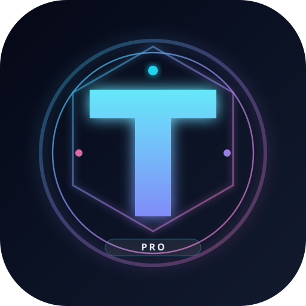

# TITAN Pro Android

**TITAN Pro V75** — اپلیکیشن اندروید تحلیل کریپتو (چند تایم‌فریم، الگو، AI، Edge Router)

> **Analysis only** — هیچ سفارش واقعی اجرا نمی‌شود.


## لوگو

<p align="center">
  
</p>

طراحی نئونی شیک با حرف **T** و هاله شفق قطبی (cyan / violet).

## ویژگی‌ها

- رابط WebView تمام‌صفحه با تم تیره نئون
- اتصال به سرور محلی TITAN (`http://127.0.0.1:5000`) یا آدرس سفارشی
- Splash screen با لوگو
- Adaptive icon برای لانچر اندروید
- مجوزهای شبکه و ذخیره‌سازی (پوشه LLL)
- بیلد خودکار APK با GitHub Actions

## ساخت APK از GitHub

1. به تب **Actions** بروید
2. workflow **Build APK** را اجرا کنید (`Run workflow`)
3. پس از اتمام، از بخش **Artifacts** فایل `titan-pro-debug.apk` را دانلود کنید

یا روی گوشی با Android Studio باز کنید و **Build → Build APK** بزنید.

## اجرا روی گوشی

### حالت A — سرور روی خود گوشی (Termux)

```bash
# در Termux
pkg install python git
pip install flask requests numpy pandas urllib3 websocket-client
# فایل TITAN_PRO_V75_PWA.py را در Termux کپی کنید
python TITAN_PRO_V75_PWA.py
```

سپس اپ اندروید را باز کنید (پیش‌فرض `http://127.0.0.1:5000`).

### حالت B — سرور روی PC / VPS

در اپ، از منوی تنظیمات آدرس سرور را تغییر دهید، مثلاً:
`http://192.168.1.10:5000`

## ساختار پروژه

```
TITAN-Pro-Android/
├── app/
│   ├── build.gradle.kts
│   ├── src/main/
│   │   ├── AndroidManifest.xml
│   │   ├── java/com/titan/pro/
│   │   │   ├── MainActivity.kt
│   │   │   └── SplashActivity.kt
│   │   └── res/
│   │       ├── drawable/     # لوگو و آیکون‌ها
│   │       ├── mipmap-*/     # adaptive icons
│   │       ├── layout/
│   │       ├── values/
│   │       └── xml/
├── assets/logo/              # لوگو SVG شیک
├── gradle/
├── build.gradle.kts
├── settings.gradle.kts
├── .github/workflows/build-apk.yml
└── README.md
```

## مجوزها

- `INTERNET`
- `ACCESS_NETWORK_STATE`
- `READ/WRITE_EXTERNAL_STORAGE` (برای همخوانی با پوشه LLL در نسخه سرور)

## هشدار

این نرم‌افزار **فقط برای تحلیل** است و توصیه سرمایه‌گذاری یا اجرای سفارش نیست. استفاده از بازارهای مالی ریسک دارد.

## لایسنس

MIT — استفاده آزاد با ذکر منبع.
